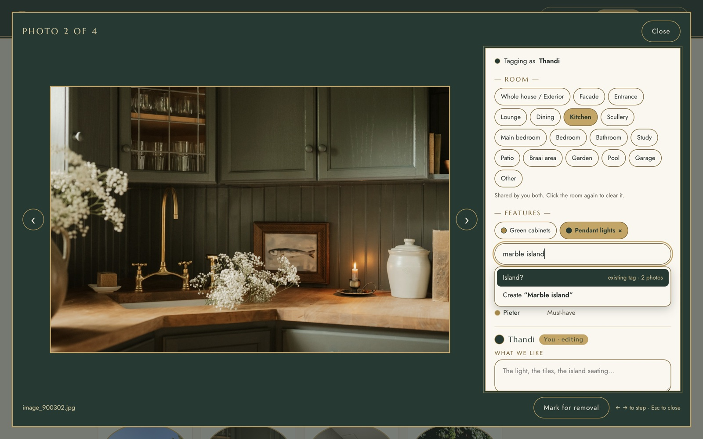
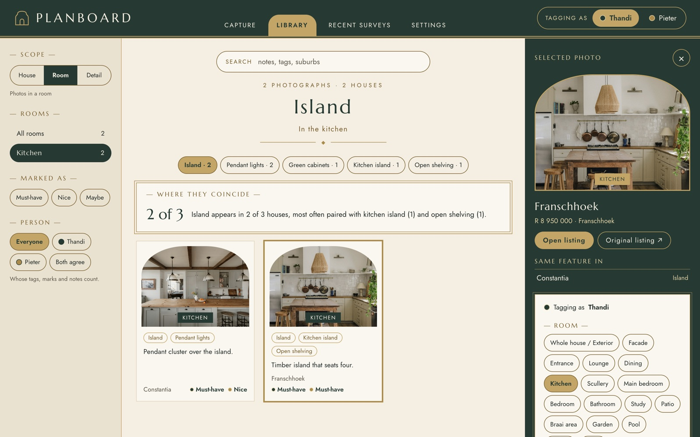
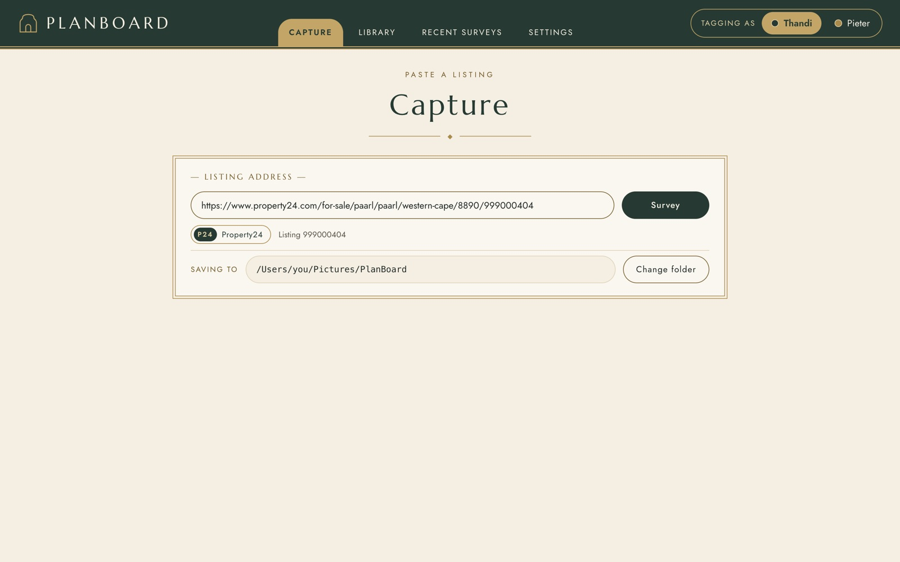
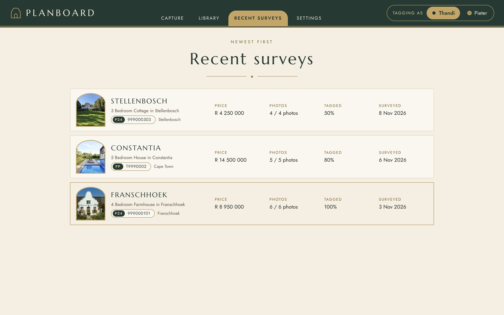
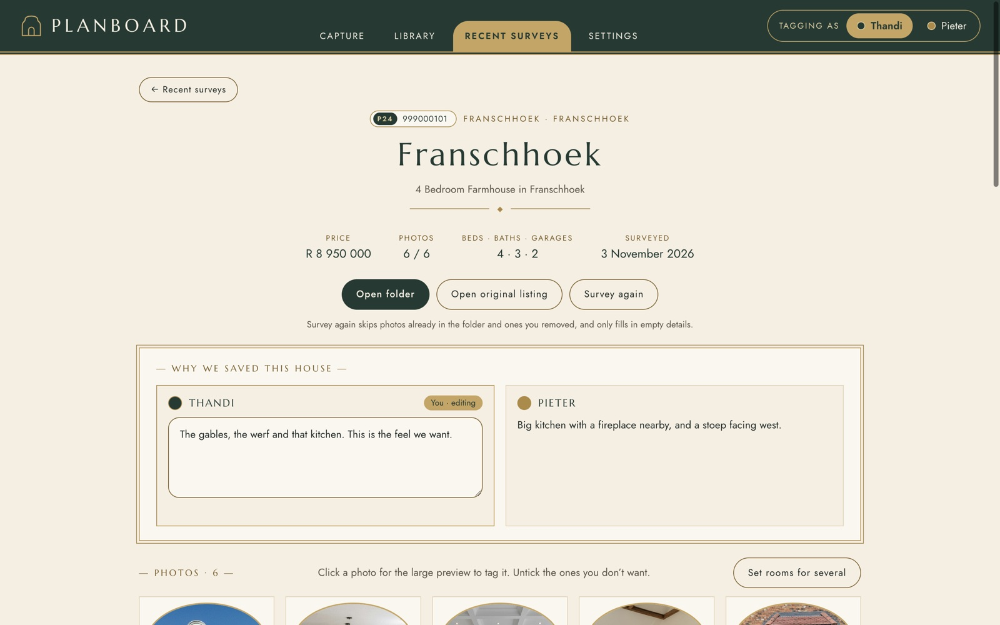
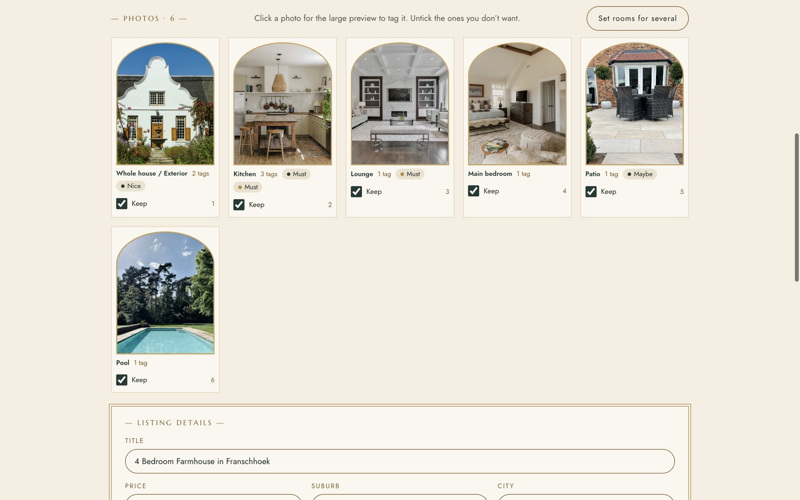
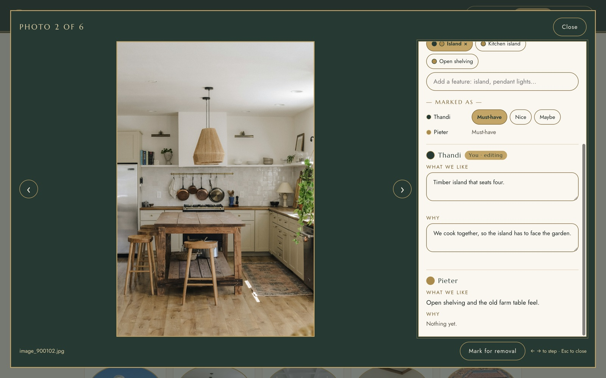
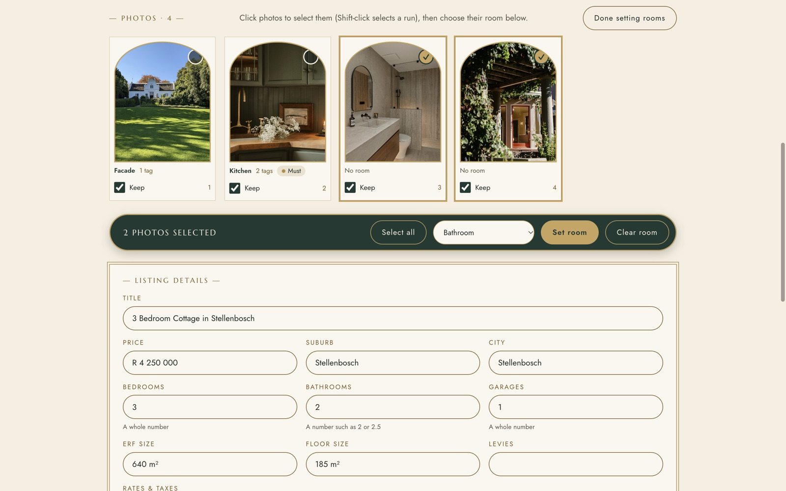
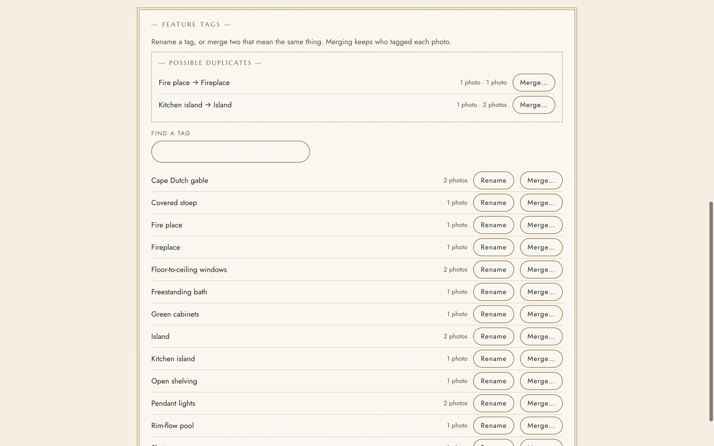
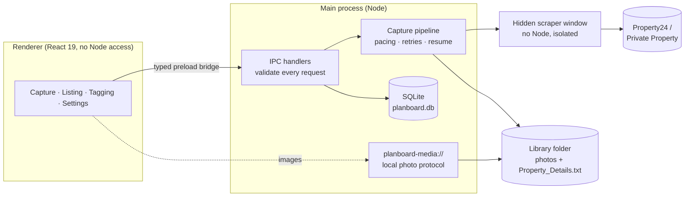

<div align="center">

# PlanBoard

**A desktop app for two people planning a house together.**<br>
Save property listings, keep every photo, and tag what you love: room by room, feature by feature.




<sub>Tagging a kitchen photo. Typing “marble island” suggests the existing <b>Island</b> tag before creating a near-copy.</sub>

</div>

---

## Why it exists

My partner and I are designing a house. Our inspiration lives on South African property sites (Property24 and Private Property), where listings disappear once they sell and photos are hard to compare across houses.

PlanBoard turns that scattered browsing into a shared, searchable library. You paste a listing link; it saves every photo and the listing details to a folder on your Mac; then each of you tags the photos with the room, the features you noticed, a **Must-have / Nice / Maybe** mark, and a note on what you like and why. Over time the tags show which features keep coming up across houses.

It started as a small Python download script ([`reference/images_downloader.py`](reference/images_downloader.py)) and grew into a full desktop app.

## Tech stack

| Area | Tools |
| --- | --- |
| Desktop app | Electron 45 (macOS), electron-vite 6 and Vite 8 for builds, electron-builder for packaging |
| User interface | React 19, TypeScript 6 in strict mode, hand-written CSS with design tokens, Marcellus and Jost fonts bundled via Fontsource |
| Data | SQLite through better-sqlite3 13, step-up migrations on `PRAGMA user_version` |
| Scraping and downloads | A hidden, Node-free Electron window running page scripts; Chromium's network stack (`net.fetch`); node-html-parser |
| Testing and quality | Vitest 5 (391 tests), ESLint 10 with typescript-eslint and the React hooks rules, Prettier |
| AI-assisted workflow | Claude Code, guided by a written spec, project rules and per-milestone progress logs |

## Skills this project shows

- **Desktop app architecture and security:** separate main and UI processes, a typed IPC bridge, validation of every request from the UI, and a custom file protocol with path checks ([`ipc.ts`](src/shared/ipc.ts), [`preload`](src/preload/index.ts), [`mediaProtocol.ts`](src/main/mediaProtocol.ts)).
- **Data modelling and SQL:** a normalised schema with per-person records, transactions, upserts, migrations, and a tag merge that removes duplicates ([`db/`](src/main/db)).
- **Reliable scraping and networking:** site-specific modules, retries with backoff, polite pacing, resumable downloads and a manual fallback when a site changes ([`scrapers/`](src/main/scrapers), [`capture/`](src/main/capture)).
- **Algorithms:** fuzzy text matching with normalisation, simple plural handling, edit distance and ranked suggestions ([`tagMatch.ts`](src/shared/tagMatch.ts)).
- **Front-end engineering:** React hooks, autosave with debouncing, an accessible auto-complete (ARIA combobox), a focus-trapped modal, keyboard navigation and a token-based design system ([`renderer/`](src/renderer/src)).
- **Testing:** test-driven development, dependency injection so the network and file system can be faked, and redacted real-page fixtures ([`test/fixtures/`](test/fixtures)).
- **Product and UX thinking:** a two-person workflow, milestone planning, and a visual identity carried through every screen ([`PROJECT_BRIEF.md`](PROJECT_BRIEF.md)).
- **Working effectively with AI:** spec-first planning, written guardrails, small verified commits and resumable progress notes ([`CLAUDE.md`](CLAUDE.md), [`docs/progress/`](docs/progress)).

## Features

<table>
<tr>
<td width="50%" valign="top">

**The inspiration library**<br>
Every tagged photo in one place. Browse by house, room or feature; filter by mark and by person, including **Both agree**; and search notes, tags and suburbs. A banner shows where features coincide (“Island appears in 2 of 3 houses, most often paired with…”), and the side panel lists the other houses with the same feature.

</td>
<td width="50%"></td>
</tr>
<tr>
<td valign="top">

**Capture a listing**<br>
Paste a Property24 or Private Property link. The site and listing are recognised straight away, then a hidden browser window reads the gallery and every photo is downloaded with polite pacing, retries and a progress bar named after building stages (*Survey → Foundation → Framing → Handover*).

</td>
<td></td>
</tr>
<tr>
<td valign="top">

**Recent surveys**<br>
Every saved house with its price, photo count and how much of it you've tagged.

</td>
<td></td>
</tr>
<tr>
<td valign="top">

**Listing view**<br>
Editable listing details, a “Why we saved this house” note for each person, and quick links to the folder and the original listing. Untick photos you don't want and they go to the macOS Trash, never a permanent delete.

</td>
<td></td>
</tr>
<tr>
<td valign="top">

**Tag at a glance**<br>
Each thumbnail shows its room, tag count and each person's mark in their own colour.

</td>
<td></td>
</tr>
<tr>
<td valign="top">

**Two people, one library**<br>
Switch “Tagging as” in the header. You can edit only your own marks and notes; your partner's appear beside yours, read-only. Notes save themselves as you type.

</td>
<td></td>
</tr>
<tr>
<td valign="top">

**Set rooms in bulk**<br>
Select several photos (Shift-click selects a run) and give them a room in one go.

</td>
<td></td>
</tr>
<tr>
<td valign="top">

**Keep tags tidy**<br>
Rename or merge tags. PlanBoard spots likely duplicates (“Fire place” → “Fireplace”), and a merge keeps who tagged each photo.

</td>
<td></td>
</tr>
</table>

## Design

The look is **Cape Dutch meets Art Deco**: bottle green and brass, arched gable photo frames, `— LABEL —` headings, a ◆ divider and pill-shaped controls. Type is Marcellus for headings and Jost for text, bundled with the app. Every colour is a CSS variable in one file ([`tokens.css`](src/renderer/src/styles/tokens.css)), text meets 4.5:1 contrast, and controls are at least 36–44 px with visible keyboard focus.

## How it works



- **Self-contained library.** The database and photos live in one folder you choose (`~/Pictures/PlanBoard` by default), so it's easy to back up or move.
- **Locked-down Electron.** `contextIsolation` on, `nodeIntegration` off, and one typed preload bridge. The renderer is never trusted: every IPC request is shape-checked in main. The hidden scraping window has no Node access, and local photos are served through a custom protocol that only returns image files inside the library.
- **Safe with your data.** Removed photos go to the macOS Trash. Schema changes are step-by-step migrations tracked with `PRAGMA user_version`. A checksum line in `Property_Details.txt` means a re-survey never overwrites a file you've edited by hand. Unsaved edits hold the window open until you choose.

## Engineering highlights

- **Fuzzy tag matching** ([`tagMatch.ts`](src/shared/tagMatch.ts)): ignores case, spacing, punctuation, plurals (“benches” → “bench”, “shelves” → “shelf”) and word order, and forgives small typos (optimal string alignment distance). The same module powers auto-complete in the UI and duplicate checks in the main process.
- **Resumable, polite capture** ([`capture/`](src/main/capture)): 1 s pacing, 3 retries with 1/2/4 s backoff, content-type checks, temp-file-then-rename downloads, and skipping of photos already on disk or removed earlier. Every outside effect is injected, so the whole pipeline is unit-tested without the network.
- **Per-person data model**: one shared room per photo; tags, marks and notes recorded per person, with tag merges that keep each person's rows and drop duplicates in a single transaction.
- **Test-driven**: 345 Vitest tests across 32 files (about 4,600 lines of tests for 9,600 lines of app code). Scrapers are tested against trimmed, redacted page fixtures; database tests run against real SQLite in memory.
- **Strict tooling**: TypeScript strict mode, ESLint (including the React hooks rules), Prettier, and a typecheck before every build.

## Built with AI, on purpose

I'm an AI-assisted builder: I set the direction, make the product and design decisions, and review and test every milestone, and I use [Claude Code](https://claude.com/claude-code) to write most of the code. The working files are kept in the repo so you can see the process:

- [`PROJECT_BRIEF.md`](PROJECT_BRIEF.md): the spec, covering decisions, scraping research, data model, theme tokens and milestones.
- [`CLAUDE.md`](CLAUDE.md): the project rules the AI works within (security, testing, where things live).
- [`docs/progress/`](docs/progress): a resumable checklist per milestone, with decisions and what was verified.
- Small commits per milestone chunk, each one passing tests, typecheck and lint first.

## Roadmap

| Milestone | Status |
|---|---|
| 1. Scaffold: themed window, settings, two people | ✅ |
| 2. Scrapers for Property24 and Private Property | ✅ |
| 3. Capture flow with progress stages | ✅ |
| 4. Listing view: preview, remove to Trash, edit details | ✅ |
| 5. Tagging: rooms, feature tags, marks, notes | ✅ |
| 6. Inspiration library: filters, search, “where features coincide” insights | ✅ |
| 7. Packaged `.dmg` | ⏳ next |

## Run it locally

Needs macOS and Node.js 22.12 or newer.

```bash
git clone <this repo>
cd planboard
npm install     # also downloads Electron and prepares the SQLite module
npm run dev     # opens the app with hot reload
```

```bash
npm test            # 391 unit tests
npm run typecheck   # TypeScript, main and renderer
npm run lint        # ESLint
npm run build       # typecheck, then compile into out/
```

## Project structure

```
src/
  main/        Electron main: window, IPC, settings, library, capture pipeline
    scrapers/  site-specific URL patterns, selectors and parsers (one file per site)
    capture/   download, retry, details file, resumable run
    db/        schema, migrations, listings, notes, tagging and library queries
    tagging/   request checks and the "Tagging as" rule
  preload/     the typed bridge: the only API the UI can reach
  renderer/    React UI: capture, inspiration library, listing view, tagging, settings
  shared/      types and pure logic used by both sides (IPC types, tag matching, rooms,
               library filters and coincidence counts)
test/fixtures/ trimmed, redacted listing pages for scraper tests
```

## Responsible use

PlanBoard is a personal tool. It fetches **one listing at a time, when you ask**, with delays between requests, and never crawls search results. It is not affiliated with Property24 or Private Property; listing content belongs to its owners. If a site changes and a scraper stops working, the app fails with a clear message and offers a manual fallback.

## Credits

The screenshots use a **fictional demo library**. Listings, prices, people and notes are made up, and the photos are free-to-use images from [Unsplash](https://unsplash.com). See [`docs/screenshots/CREDITS.md`](docs/screenshots/CREDITS.md) for each photographer.

## License

[MIT](LICENSE)
